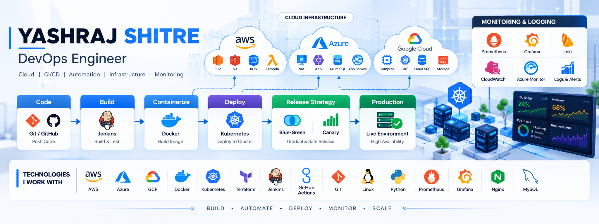

<!-- Yashraj Shitre | DevOps Engineer Profile -->

  

<h2 align="center">DEVOPS ENGINEER | CLOUD | AUTOMATION</h2>

  <b>Build • Automate • Deploy • Monitor • Scale</b>

  
  
  
  

---

## 👨‍💻 About Me

I'm a DevOps Engineer with 3+ years of experience working with cloud infrastructure, CI/CD pipelines, containerization, and automation. I focus on improving deployment workflows, infrastructure reliability, monitoring, and operational efficiency.

- ☁️ Cloud infrastructure using AWS and Microsoft Azure
- ⚙️ CI/CD automation using Jenkins, GitHub Actions, and Azure DevOps
- 🐳 Containerization using Docker and Docker Compose
- ☸️ Kubernetes deployments and troubleshooting
- 🏗️ Infrastructure as Code using Terraform
- 📊 Monitoring, centralized logging, and incident troubleshooting
- 🔐 Infrastructure security, backup automation, and recovery practices

📍 Pune, Maharashtra, India

---

## 🧰 Tech Stack & Tools

<table>
  <tr>
    <td align="center" width="20%">
      <b>☁️ Cloud Platforms</b>  
      
    </td>
    <td align="center" width="20%">
      <b>🐳 Containers</b>  
      
    </td>
    <td align="center" width="20%">
      <b>⚙️ CI/CD & IaC</b>  
      
    </td>
    <td align="center" width="20%">
      <b>💻 Development</b>  
      
    </td>
    <td align="center" width="20%">
      <b>📊 Monitoring & DB</b>  
      
    </td>
  </tr>
</table>

### Core Technologies

| Category | Tools & Technologies |
|---|---|
| ☁️ Cloud | AWS, Microsoft Azure, GCP fundamentals |
| 🐳 Containers | Docker, Docker Compose, Kubernetes |
| 🔄 CI/CD | Jenkins, GitHub Actions, Azure DevOps |
| 🏗️ Infrastructure as Code | Terraform, CloudFormation, ARM Templates |
| 🐧 Scripting | Linux, Bash, Python |
| 📈 Monitoring | Prometheus, Grafana, CloudWatch, Azure Monitor |
| 📝 Logging | Loki, Promtail |
| 🔀 Version Control | Git, GitHub |
| 🔐 Security | Docker image hardening, Linux security, Trivy |

---

## ⚡ Current Focus

  
  
  

### ☸️ Kubernetes & Container Orchestration

- Deployments, services, ingress, ConfigMaps, and Secrets
- Troubleshooting pods, networking, resource limits, and failed deployments
- Helm charts and application release management

### 🏗️ Cloud & Infrastructure Automation

- Reusable Terraform modules and infrastructure provisioning
- AWS and Azure networking, IAM, security, and availability
- Infrastructure optimization and cost awareness

### 🔄 CI/CD & Release Engineering

- Jenkins, GitHub Actions, and Azure DevOps pipeline automation
- Automated builds, testing, deployment, and rollback workflows
- Blue-green and canary deployment strategies

### 📊 Monitoring, Logging & Reliability

- Prometheus and Grafana dashboards and alerting
- Centralized logging using Loki and Promtail
- Incident investigation, log analysis, and
